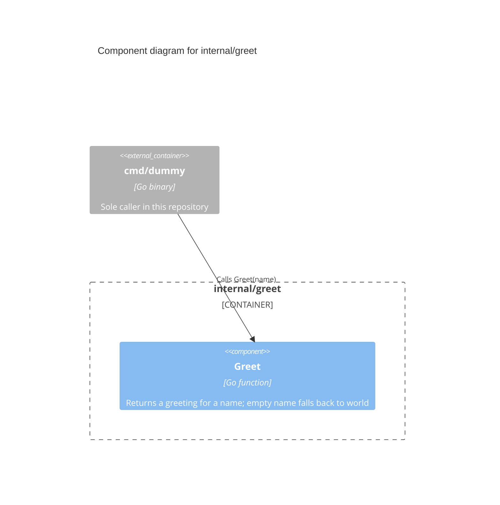

# C4 Level 3: Component

Doc-ID: ARCH-COMPONENT-GO-REPO
Version: 1.0.0
Updated-UTC: 2026-10-16T11:37:00Z

The internals of `internal/greet`, the only package holding reusable logic in this template.

## Notes

- The package is a single exported function; it exists to give the template one real, tested code path.
- As the package grows, each exported type or function group becomes its own component here.
