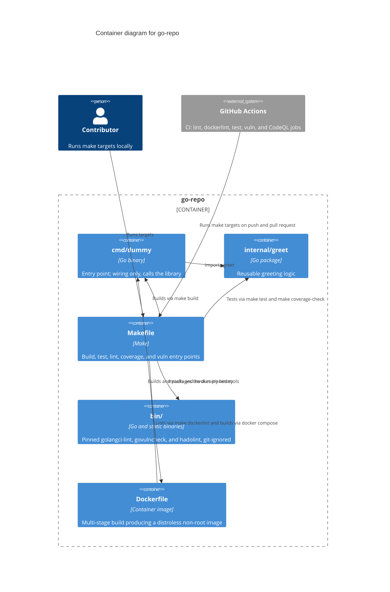

# C4 Level 2: Container

Doc-ID: ARCH-CONTAINER-GO-REPO
Version: 1.1.0
Updated-UTC: 2026-10-16T12:52:00Z

The runnable and buildable units inside `go-repo`. A "container" in C4 terms is anything that executes or is built: the binary, the library package, the tool binaries, and the CI pipelines.

## Notes

- `bin/` is a container because it holds executables, but it is git-ignored and MUST NOT be committed.
- `internal/greet` is the only package holding reusable logic; `cmd/dummy` MUST stay wiring-only.
