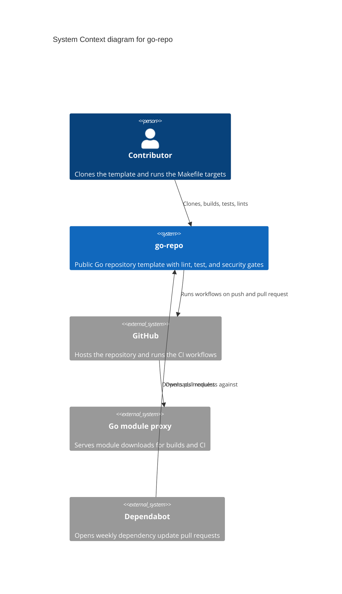

# C4 Level 1: System Context

Doc-ID: ARCH-CONTEXT-GO-REPO
Version: 1.0.0
Updated-UTC: 2026-10-16T11:37:00Z

Who uses `go-repo` and which external systems it depends on. This file is the worked example for the format required by `AGENTS.md` under Architecture modeling (C4).

## Notes

- `repo` is the system boundary: everything inside is this repository, everything else is external.
- There is no runtime service. The template is consumed at build and CI time only.
